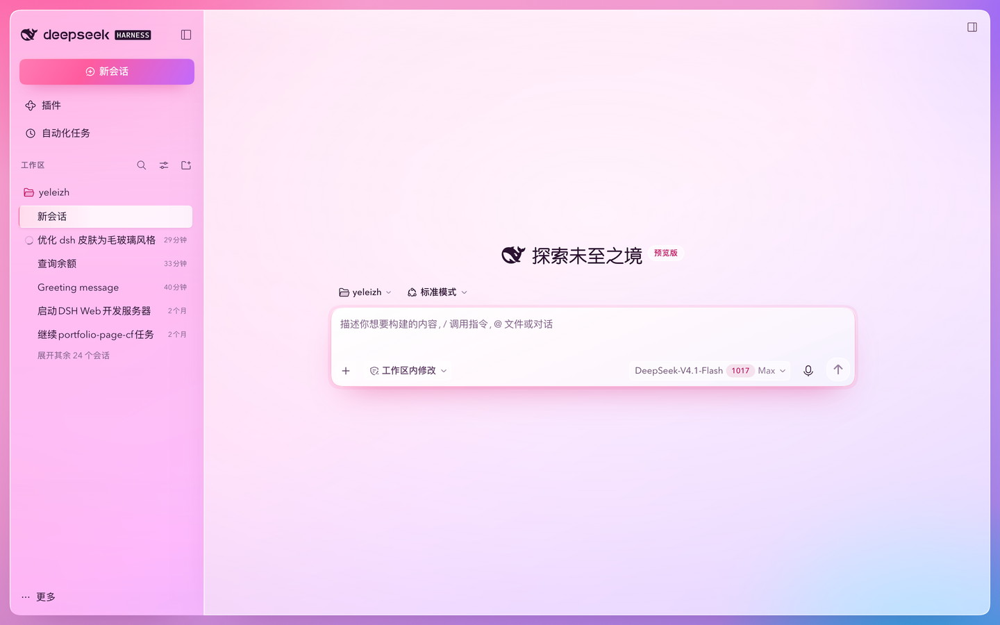
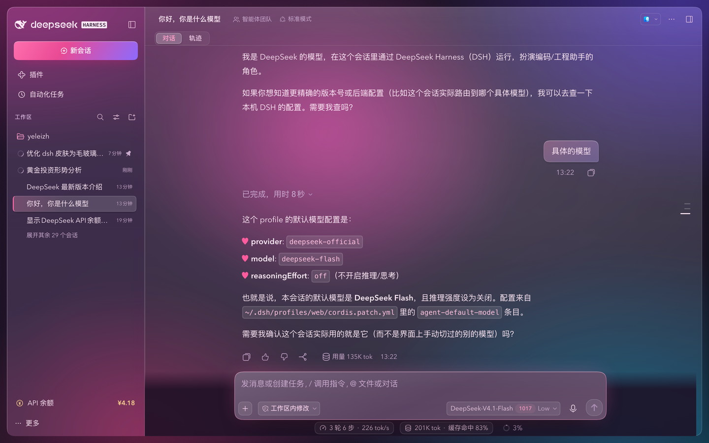

# 雾面玻璃 · dsh 皮肤

[English](./README.md)

给 DeepSeek Harness 网页端的换皮肤：一张低饱和的石色到雾蓝桌面，桌面上浮着
一整扇中性白毛玻璃窗，全站只有一种强调色：石墨。

## 截图

白天 | 夜间
---|---
 | 

## 毛玻璃是怎么做出来的

- **玻璃得有个桌面可透。** body 铺一张低饱和的石色到雾蓝渐变加中性暗角，整扇
  应用四周留 14px 生底浮在上面。玻璃要有边界，才读得出来是玻璃。
- **除了语义色，没有色相。** 灰阶、墨色、发丝线、阴影全是中性的。只有成功、
  警告、错误保留颜色。
- **只有一种强调色。** 石墨（夜间反相成近白），只用在「新会话」「发送」和开关
  开态上，都是实色，不渐变、不发光。
- **全套只有一种阴影语言。** 每个面都是「内侧 1px 亮边 + 内顶 1px 高光 + 外侧
  0.5px 发丝线 + 一团中性淡投影」。
- **圆角只有四档。** 8 / 12 / 16 / 18px，配 `corner-shape: superellipse(1.6)`。
- **系统字体。** 标题和正文都用 SF 和苹方，不加载任何远程字体。
- **对比度对着真实玻璃算。** 墨色 / 次级 / 弱化字是拿渲染后的面色量的：白天
  15:1 / 8:1 / 4.9:1，夜间 11:1 / 7:1 / 4.9:1。
- **该退的时候退。** 系统要求减少透明时，玻璃退回实色；要求减少动效时，全站
  过渡直接关掉。

## 悬浮展开侧栏

皮肤还带一个小功能：侧栏收起时，鼠标在左上角的鲸鱼图标上停一下（约 0.15 秒）
就会展开，不用点。展开后不会自动收回，照旧用侧栏右上角的收起按钮或 ⌥⌘B 收起。
只认鼠标，触屏不受影响。

## 安装

三步搞定：

**1.** `~/.dsh/profiles/web/package.json` 的 `dependencies` 里加一行：

```json
"dsh-skin-kawaii2000": "github:shunkwon/dsh-skin-kawaii2000"
```

**2.** `~/.dsh/profiles/web/cordis.patch.yml` 里加一段：

```yaml
- insert:
    - id: skin-kawaii2000
      name: dsh-skin-kawaii2000
```

**3.** 装包、重启 dsh：

```bash
cd ~/.dsh/profiles/web
pnpm install
```

装好后打开 http://127.0.0.1:3080 就能看到。

> 包名仍是 `dsh-skin-kawaii2000`，loader 里那行也不用改。外观改过两次：2.0 把
> 2000 年代的斜角换成糖果毛玻璃，3.0 去掉了糖果色。id 一直沿用，现有 profile
> 不用改 patch 就能升级。v1 那一版留在 git 的 `v1-kawaii2000` 标签上，v2 糖果
> 毛玻璃是提交 `d48950b`。

### 不想用了？

给 patch 里那行加 `disabled: true` 再重启，或者把上面加的两处都删掉。

## License

[MIT](./LICENSE)

## 维护提示：`[class*=…]` 请只挂一层

皮肤靠 `[class*="_xxx"]` 匹配组件内部类名（类名形如 `<hash>_<local>`，后缀稳定）。
substring 匹配很容易命中嵌套子节点 —— 比如 `[class*="_card"]` 会同时命中
`li.card` 和 `cardHead` / `cardMain` / `cardDesc` / `cardIcon`，给每一层都套上
圆角描边，看起来像一条白条盖住了文字。

改完样式后，在浏览器控制台粘 [tools/audit-nesting.js](./tools/audit-nesting.js)
跑一遍（插件页、设置→内置插件、对话、首屏各跑一次），输出为空才算干净。
